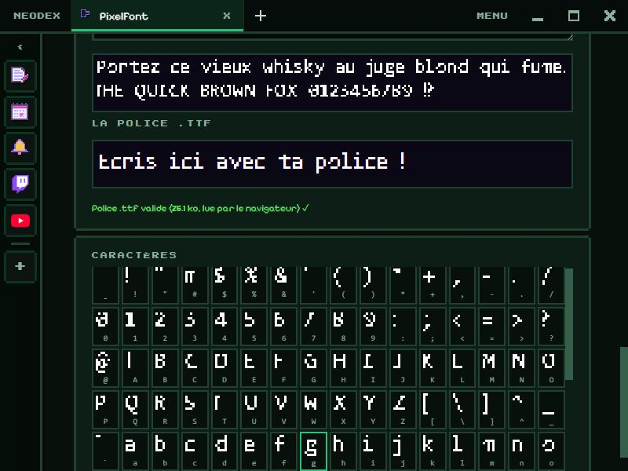

# PixelFont

Draw your pixel art font, letter by letter, and install it in Windows like any other font.

*Version française : [README.md](README.md)*

## Drawing

- 125 characters: ASCII, French accents (à, é, ç, œ…), €, « » quotes, ’ apostrophe, ellipsis…
- Grid up to 16 × 16. **Left click** to draw, **right click** to erase, by dragging. Keyboard **arrows**: next or previous letter, **Ctrl+Z**: undo.
- Each letter has its own **width** (blue line): ◀ ▶ or **Fit** to the last drawn column. The **baseline** is pink.
- Tools: clear, invert, mirror, shift in 4 directions, copy-paste a letter, undo.

## Settings

Font name, grid width and height, rows below the baseline (for g, p, q, y), letter spacing. **Start from a font** fills every letter from a system font (monospace, sans-serif or serif): a good starting point to touch up.

## Preview and export

- A preview text drawn in pixels, and an area to write with **the real .ttf font**, built and loaded on every change: if the browser accepts it, it shows in green.
- **Export .ttf**: a TrueType font. Double-click the file to install it in Windows, then use it in your software.
- **PNG sheet + JSON**: every letter on one image (16 per row) with their positions and widths, for a game.

## Data

The letters, the settings and the preview text are kept in the plugin folder. Permission: `storage` only.
