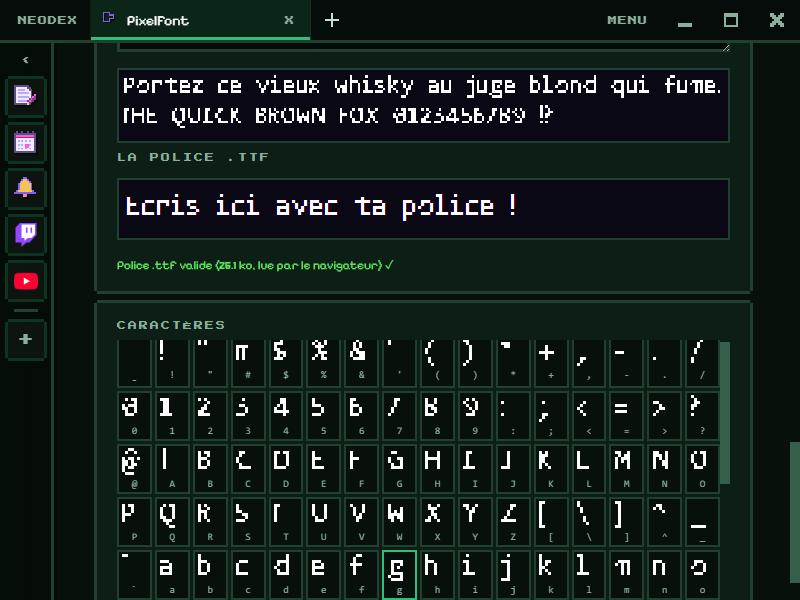

# PixelFont

Dessine ta police pixel art, lettre par lettre, et installe-la dans Windows comme n'importe quelle police.

*English version: [README.en.md](README.en.md)*

## Dessiner

- 125 caractères : ASCII, accents français (à, é, ç, œ…), €, guillemets « », apostrophe ’, points de suspension…
- Grille jusqu'à 16 × 16. **Clic gauche** pour dessiner, **clic droit** pour effacer, en glissant. **Flèches** du clavier : lettre suivante ou précédente, **Ctrl+Z** : annuler.
- Chaque lettre a sa **largeur** (trait bleu) : ◀ ▶ ou **Ajuster** à la dernière colonne dessinée. La **ligne de base** est en rose.
- Outils : effacer, inverser, miroir, décaler dans les 4 sens, copier-coller une lettre, annuler.

## Réglages

Nom de la police, largeur et hauteur de la grille, nombre de lignes sous la ligne de base (pour g, p, q, y), espace entre les lettres. **Repartir d'une police** remplit toutes les lettres d'après une police du système (chasse fixe, sans ou avec empattement) : un bon point de départ à retoucher.

## Aperçu et export

- Un texte d'aperçu dessiné en pixels, et une zone où écrire avec **la vraie police .ttf**, fabriquée et chargée à chaque changement : si le navigateur l'accepte, c'est affiché en vert.
- **Exporter .ttf** : une police TrueType. Double-clique sur le fichier pour l'installer dans Windows, puis utilise-la dans tes logiciels.
- **Planche PNG + JSON** : toutes les lettres sur une image (16 par ligne) et leurs positions et largeurs, pour un jeu.

## Données

Les lettres, les réglages et le texte d'aperçu sont gardés dans le dossier du plugin. Autorisation : `storage` seulement.
